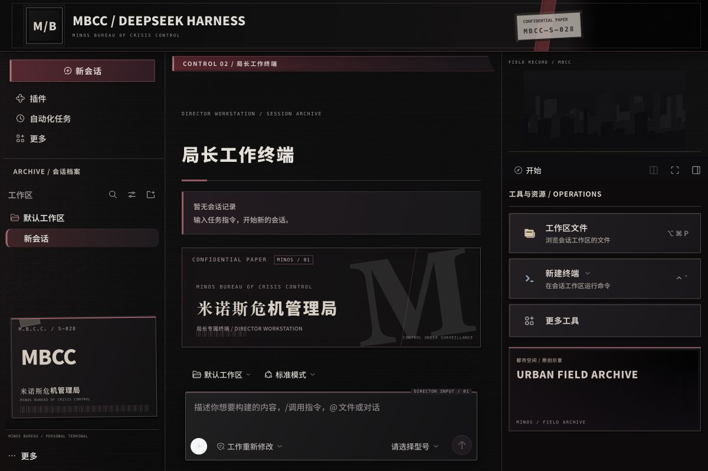
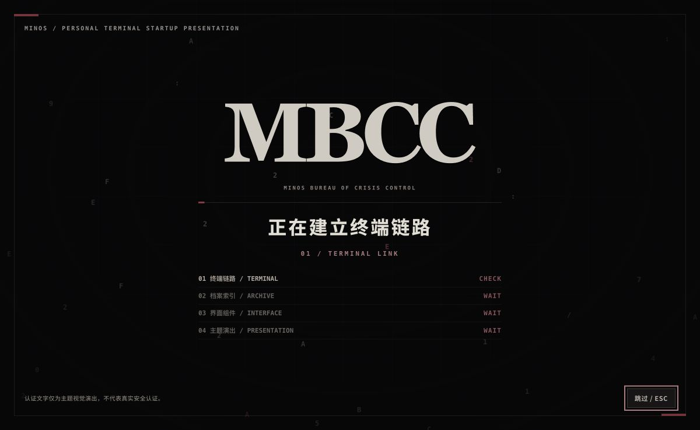

# MBCC · DeepSeek Harness Theme

[中文](./README.md)

**dsh-theme-mbcc 0.1.0** is an unofficial fan-made visual theme for DeepSeek Harness, inspired by the urban institutional archives of **Path to Nowhere**: charcoal surfaces, restrained dark-red print accents, substantial typography, layered dossiers, and a flowing-data startup presentation.

It installs as a native **Bundle plugin**. It does not modify `app.asar`, the application bundle, or its code signature. Compatibility is pinned to **DeepSeek Harness 0.2.1-rc.3**; other versions require adaptation and verification.

## Appearance and scope

- A shared black-and-red archival surface across conversation, composer, sidebar, and tools.
- Bundled Noto Sans SC faces for body and interface text at weights 500, 650, 700, and 900.
- A skippable flowing-data startup presentation that respects the system's reduced-motion preference.
- Project-authored procedural textures and textual identity by default, with optional artwork loaded from a local directory supplied by the user.
- The host's native sidebar widths and resizing behavior remain intact. Earlier locally patched builds changed width constants; this plugin does not reproduce those screenshots pixel for pixel.

Words such as “authentication” and “access granted” in the animation are visual storytelling. The animation does not authenticate users, validate keys, or change permissions, and is not a replacement for the host's security mechanisms.

This project is not affiliated with or endorsed by DeepSeek or the creators of Path to Nowhere. Official game images, logos, and the website font are not included in the public package.



This is a real screenshot from an isolated Harness environment without account credentials, using the included graphics. The native right sidebar was resized by dragging. See [0.1.0 verification](./docs/verification.md) for the tested scope.



## Installation

Confirm that the host is **0.2.1-rc.3**. If you previously used a theme that patched `app.asar`, restore your original backup or reinstall the official application of the same version before installing this plugin. This avoids stacking two visual modifications. Do not delete the application's user-data directory.

### Install from GitHub

Open the installation entry in DeepSeek Harness's plugin manager and paste this package spec into the package-address field:

```text
github:anosaki258-dot/deepseek-harness-mbcc-theme
```

Enable **dsh-theme-mbcc** after installation. Restart DeepSeek Harness if the current page does not reload the theme.

This is a GitHub package spec; it does not imply that the package is published to npm. The repository's built `lib` output is provided for the host's plugin loader.

### Install a local tarball

Build and package from the repository directory:

```sh
npm install
npm run build
npm test
npm pack
```

Paste the full local path of the resulting `dsh-theme-mbcc-0.1.0.tgz` into the host's plugin installation field, then enable it. Do not extract the tarball over the application directory.

## Configuration

Set these fields in the Host's **dsh-theme-mbcc Bundle configuration**. This is the plugin's configuration object, not a complete application configuration file:

```json
{
  "startup": true,
  "fullLayout": true,
  "artDirectory": ""
}
```

| Field | Default | Meaning |
|---|---|---|
| `startup` | `true` | Play the startup presentation; set to `false` to enter the workspace directly. |
| `fullLayout` | `true` | Enable the full archival decoration and layout styling without changing native column-width constants. |
| `artDirectory` | `""` | Optional local image directory. An empty value uses the default project-authored appearance. |

Restart the application if a configuration change does not take effect immediately.

### Optional game-inspired artwork

Place images you have the necessary rights to use in a local folder and set `artDirectory` to that folder's full path. Images are supplied to all clients connected to this Host; do not use private images. Restart the Host after changing configuration. The following exact filenames are recognized; provide only those you need:

```text
mbcc-seal.png
mbcc-original-wordmark.png
mbcc-official-discity.png
mbcc-field-record.png
mbcc-official-map.png
```

They are used for the emblem, game wordmark, DisCity scene, office archive image, and map panel respectively. These files are not part of the distributed plugin and are not automatically uploaded to the repository. Missing optional images use the default visual fallback. Do not commit your local artwork folder, personal path configuration, or account screenshots to a public repository.

See [THIRD_PARTY_NOTICES.md](./THIRD_PARTY_NOTICES.md) for source identification and rights boundaries. Public availability on the official website does not grant redistribution rights through this project.

## Disable or uninstall

Disable or uninstall **dsh-theme-mbcc** in the native plugin manager. Restart if cached styling remains visible. No `app.asar` restoration is required because this plugin does not modify it. Removing the theme does not require deleting conversations, workspaces, or account data.

## Development and verification

```sh
npm install
npm run build
npm test
npm pack
```

Commit build output matching the source before release, and inspect the `npm pack` file list. Package only the plugin files. Do not include the host application, ASAR archives, extracted application source, user profiles, official artwork, or personal screenshots.

The visual selector compatibility layer targets **0.2.1-rc.3**. Host updates can change the structure or styling, so do not broaden compatibility without verification. A successful build or automated test run is not evidence of installation on every operating system or a successful online model request. Refer to the matching release notes for actual verification results.

## License

Project-authored code, documentation, and procedural textures use the [MIT license](./LICENSE). Bundled Noto font derivatives remain under [SIL OFL 1.1](./assets/fonts/OFL.txt); see the [font notice](./assets/fonts/FONT-NOTICE.md). Game names, marks, and user-supplied artwork remain the property of their respective rights holders and are not relicensed under MIT.
